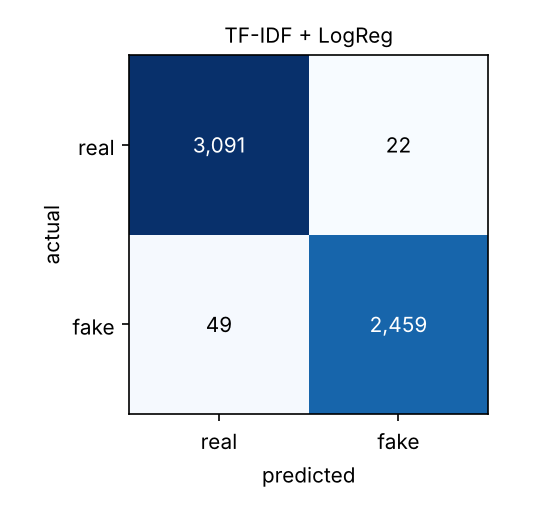

# Fake News Detection: Do You Really Need an LLM?

Benchmark of three ways to detect fake news on the [ISOT Fake and Real News dataset](https://www.kaggle.com/datasets/clmentbisaillon/fake-and-real-news-dataset), comparing **quality, latency and cost** on the same test articles:

| Approach | What it is | Runs on |
|---|---|---|
| **TF-IDF + logistic regression** | Classical baseline, word 1–2 grams | CPU, milliseconds |
| **DistilBERT, fine-tuned** | Small transformer trained on the task | GPU to train, CPU to serve |
| **LLM, zero-shot / few-shot** | General-purpose model prompted through an API | Paid API |

The question behind it is the one teams ask before shipping: *is a large model worth its cost here, or does a cheaper model do the job?*

## What does "99% accuracy" actually measure?

Most public notebooks on this dataset report ~99% accuracy. Part of that comes from **where the articles were scraped**, not from whether they are fake:

- almost every real article starts with a Reuters dateline (`WASHINGTON (Reuters) - …`);
- fake articles carry their own source marks (`Featured image via …`, `Via: Zero Hedge`, `(VIDEO)` in titles, "READ MORE … SUPPORT OUR WORK BY SUBSCRIBING" footers);
- the `subject` column alone predicts the label perfectly, because its categories never overlap between classes;
- thousands of articles are duplicated, so the same text can land in train and test.

[`src/fakenews/data.py`](src/fakenews/data.py) strips these markers, drops `subject`, removes empty and duplicated articles (44,898 → 37,467), then splits the data (stratified random, or temporal with `--strategy temporal`). [`src/fakenews/audit.py`](src/fakenews/audit.py) measures what each step changes, using the same baseline.

<!-- RESULTS:AUDIT -->
| Setting | Articles | Test accuracy | F1 (fake) | FPR |
|---|---:|---:|---:|---:|
| `subject` column only (no text) | 44,898 | 100.00% | - | - |
| TF-IDF + LogReg, raw text | 37,554 | 99.06% | 0.9894 | 0.51% |
| TF-IDF + LogReg, cleaned text | 37,467 | 98.51% | 0.9831 | 0.67% |
| TF-IDF + LogReg, cleaned text + weekday names masked | 37,467 | 98.13% | 0.9789 | 0.96% |
| TF-IDF + LogReg, cleaned text, temporal split (test 2017-11-04 to 2018-02-19) | 37,467 | 98.22% | 0.9283 | 1.73% |

Random splits are stratified (44.6% fake in every split). The temporal split trains on the oldest 70% of articles and tests on the most recent 15%, where only 661 of 5,621 test articles are fake: the class balance shifts over time, which is part of what makes it harder.

**What this shows:**

1. **The explicit leaks are real but explain little.** Removing datelines, credits and footers costs only ~0.5 point of accuracy. The `subject` column is a perfect leak, so it is dropped.
2. **What remains is house style.** After cleaning, the strongest "real" n-grams are wire-service conventions (`said on`, `on wednesday`, `president donald`); the strongest "fake" ones are blog tone (`just`, `this`, `watch`, `president trump`, `obama`). Masking weekday names barely moves the score. The labels come from the source, so a model mostly learns *Reuters style vs partisan-blog style*.
3. **Time matters more than leaks.** Trained on articles up to September 2017 and tested on November 2017 to February 2018, F1 (fake) falls from 0.983 to 0.928 and the false positive rate more than doubles. The random split overstates how the model would perform on next month's news.

See [results/leakage_audit.md](results/leakage_audit.md) for the top n-grams in each setting.
<!-- /RESULTS:AUDIT -->

## Results

<!-- RESULTS:MAIN -->
### Full test set (5,621 articles)

| Model | n | Accuracy | F1 (fake) | Recall (fake) | FPR | Latency (ms/article) | Cost / 1k articles |
|---|---:|---:|---:|---:|---:|---:|---:|
| TF-IDF + LogReg | 5,621 | 98.74% | 0.9858 | 98.05% | 0.71% | 0.83 | $0.00 |



> DistilBERT and LLM results are added by running `make transformer` (GPU) and `make llm`; the head-to-head table and the quality-vs-cost chart appear automatically once LLM predictions exist.

**Error analysis (baseline).** The 22 false positives (real articles flagged as fake) are mostly full transcripts quoted by Reuters (Romney's speech on Trump, Comey's prepared testimony) and first-person feature stories: the voice is the speaker's, not the wire reporter's. Many of the 49 false negatives are fake-site articles that paste or paraphrase wire copy ("The agency said Thursday…"). Both confirm the model reads *writing style*, not truthfulness.
<!-- /RESULTS:MAIN -->

All models are scored on the same cleaned test set. The LLM is evaluated on a stratified subsample to keep API costs low, and every other model is re-scored on exactly those articles for the head-to-head table. "Fake" is the positive class; FPR is the share of real articles wrongly flagged as fake.

## Demo

`app/app.py` is a Gradio app: paste a headline and an article, and every trained model gives its verdict and confidence, with the words that weighed most in the TF-IDF model's decision.

```bash
python app/app.py          # LLM column appears if OPENAI_API_KEY and LLM_MODEL are set
```

## Reproduce

```bash
git clone https://github.com/aminecharfeddine/fake-news-llm-benchmark.git
cd fake-news-llm-benchmark
pip install -e ".[transformer,llm,app,dev]"

# 1. Data (needs a Kaggle API token)
kaggle datasets download -d clmentbisaillon/fake-and-real-news-dataset -p data/raw --unzip
make data          # clean + split  -> data/processed/
make audit         # leakage audit  -> results/leakage_audit.md

# 2. Models
make baseline      # TF-IDF + LogReg, C tuned on validation
make transformer   # DistilBERT; use a GPU (notebooks/train_transformer_colab.ipynb runs it on Colab)
make llm MODEL=<openai-model> PRICE_IN=<$ per 1M input tokens> PRICE_OUT=<$ per 1M output tokens> SHOTS=0

# 3. Compare
make report        # tables + figures -> results/
make test          # unit tests
```

Prices are passed explicitly because they change: check the provider's pricing page. LLM answers are cached in `results/llm_cache/`, so re-running never pays twice for the same article.

## Project structure

```
src/fakenews/
  data.py              loading, leakage cleaning, deduplication, splits
  audit.py             raw vs cleaned comparison, subject-only leak
  evaluation.py        shared metrics and prediction files
  report.py            comparison tables and figures
  models/
    baseline.py        TF-IDF + logistic regression, feature importance, per-article explanation
    transformer.py     DistilBERT fine-tuning (plain PyTorch loop) and inference
    llm.py             zero/few-shot LLM classifier with cost, latency and caching
app/app.py             Gradio demo
notebooks/             GPU training on Colab
tests/                 unit tests on a synthetic dataset that reproduces the leaks
```

## Limitations

- The articles are US political news from 2016–2017, and labels are assigned by source. A model trained here recognizes the style of Reuters versus that period's partisan sites; it is not a fact-checker and would likely misjudge a factual article written in an informal style.
- Labels are assigned by source (Reuters vs sites flagged by fact-checkers), not article by article. Some "fake" articles are opinion pieces rather than fabricated stories.
- The LLM is evaluated on a subsample, so its metrics have wider confidence intervals than the other models'.

## License

MIT
